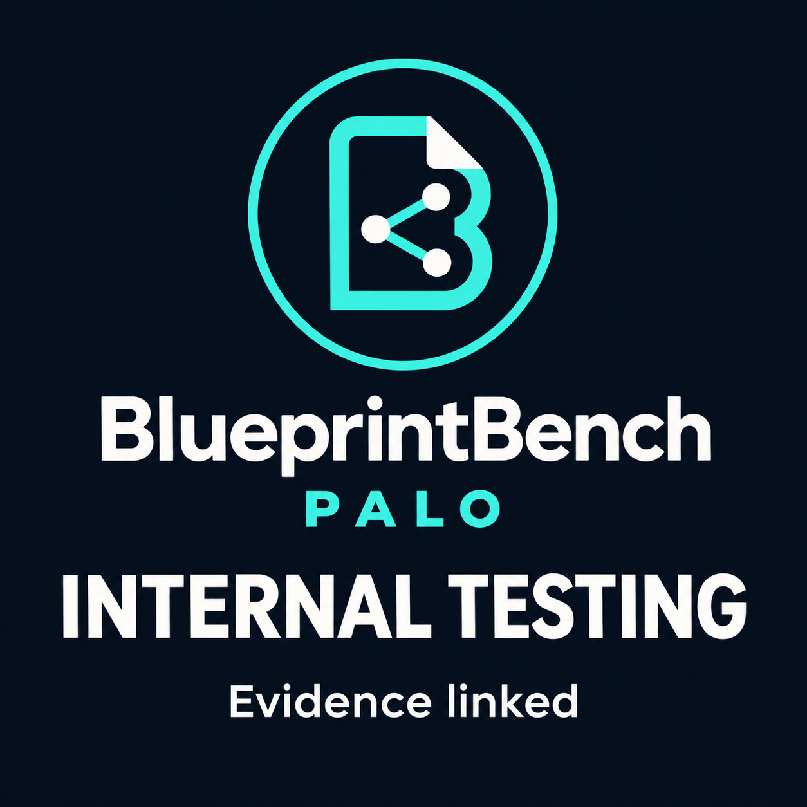
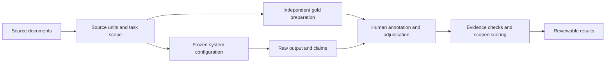

<p align="center">

> **11 November audit notice:** This is a research programme with zero qualified results. Evaluator 0.2 has a confirmed non-claim exclusion flaw and must not be used for qualification. Historical model records are adapter smoke tests on 4,994 bytes of document text. The [0.3 draft repair](https://github.com/sev7enITA/PALO-BlueprintBench/pull/1) passes 76 local tests and awaits human review; the current toolkit is still 0.2. See the [audit response](https://github.com/sev7enITA/PALO-BlueprintBench/blob/main/docs/audit-response-2026-11-11.md).

  
  
</p>

<p align="center">
  <a href="https://github.com/sev7enITA/PALO-BlueprintBench/actions/workflows/verify.yml"></a>
  <a href="LICENSE"></a>
  <a href="https://github.com/sev7enITA/PALO-BlueprintBench/releases/tag/v0.3.0-pilot.1"></a>
  <a href="docs/specification-fidelity-study.md"></a>
</p>

<h3 align="center">Preserving business meaning when AI turns documents into software specifications.</h3>

<p align="center">
  <a href="https://paloframework.org/PALO_BlueprintBench_Leaderboard.html"><b>Open the leaderboard</b></a> |
  <a href="https://paloframework.org/PALO_BlueprintBench.html"><b>Research overview</b></a> |
  <a href="https://github.com/sev7enITA/PALO-BlueprintBench/wiki"><b>Read the wiki</b></a> |
  <a href="#quick-start"><b>Run the evaluator</b></a> |
  <a href="CONTRIBUTING.md"><b>Contribute</b></a>
</p>

An AI-generated specification can look convincing while changing an obligation, losing an exception or assigning a responsibility to the wrong person. **PALO BlueprintBench studies specification fidelity:** whether the meaning of a business source survives that transformation, and how much human work is needed to repair it.

The project is an **open research pilot**. The executable evaluator, historical diagnostic evidence and contribution process are available now. The first proposed independent study focuses on procurement. **Qualified held-out results: 0. No PALO Blueprint Index score is assigned.**

| Inspect | Reproduce | Participate |
|---|---|---|
| [Model explorer](https://paloframework.org/PALO_BlueprintBench.html#explorer) | [Quick start](#quick-start) | [Contributor routes](CONTRIBUTING.md) |
| [20 benchmark references](docs/benchmark-references.md) | [Historical evidence and replay](evidence/development-2026-11-10/README.md) | [Procurement study](docs/specification-fidelity-study.md) |
| [Metrics and trust boundaries](docs/evaluator-contract.md) | [Release and packages](https://github.com/sev7enITA/PALO-BlueprintBench/releases/tag/v0.3.0-pilot.1) | [Reviewer kit](docs/reviewer-kit.md) |

## Contents

[Why specification fidelity](#why-specification-fidelity) · [Explore the project](#explore-the-project) · [Evaluation tracks](#evaluation-tracks) · [Quick start](#quick-start) · [Evidence and results](#evidence-and-results) · [Research roadmap](#research-roadmap) · [Contribute](#contribute) · [Documentation](#documentation) · [Citation](#citation) · [Governance](#governance-and-licensing)

## Why specification fidelity

| Source | Candidate specification | What needs review |
|---|---|---|
| The manager **may** approve after review. | The manager **must** approve after review. | A permission became an obligation. |
| Approval is required **unless** the purchase is exempt. | Approval is required for every purchase. | The exception disappeared. |

*Illustrative examples, not measured model results.* A valid citation or valid JSON does not establish that the business meaning is correct.

PALO's proposed study examines **modality, negation, ownership, conditions and exceptions**, together with coverage and human correction effort. It builds on established work in grounded generation, document reasoning, process modelling and evaluation infrastructure. See the [sourced comparison](docs/benchmark-references.md) for overlaps and differences.

## Explore the project

The shared catalogue contains **18 distinct model IDs and 28 configuration/cohort records**. Internal procurement tests retain **324 assigned slots, 306 dispatched requests, 299 complete responses, 7 incomplete or failed responses and 18 pre-call-blocked assignments**. Historical adapter diagnostics remain separate. Filters, sortable internal-test columns, source inspection and a call ledger expose the evidence without assigning a qualified rank.

[Interactive leaderboard](https://paloframework.org/PALO_BlueprintBench_Leaderboard.html) · [Brand assets and testing badge](docs/brand-usage.md)



<details>
<summary><b>See the document-to-blueprint review context</b></summary>


Actual Workbench pilot capture using synthetic procurement content. The entity graph, source evidence and pending decisions illustrate the workflow being studied. This image is not evidence of a qualified application release or completed benchmark campaign.

[Workbench pilot](https://paloframework.org/PALO_DocumentWorkbench.html)

</details>

## Evaluation tracks



*Protocol overview. Independent gold preparation and qualification are required study stages, not completed milestones.*

| Track | Evaluation boundary | Present state |
|---|---|---|
| **A. Interpretation** | Human-checked source units to annotated propositions | Evidence contract and synthetic scorer available; independent study proposed |
| **B. Document to blueprint** | Original PDF/XLSX through reviewed export | Development workflow; no new qualified end-to-end app release |
| **C. Control conformance** | Faults, boundaries and actual permitted effects | Protocol scope; does not imply production enforcement |

Eight research dimensions cover document fidelity, semantic faithfulness, coverage and uncertainty, ER/dictionary/ontology, process fidelity, governance controls, reliability, and human effort/FinOps. The first study narrows that programme to procurement. [Method and study design](docs/specification-fidelity-study.md).

## Quick start

**Python 3.10+**, Git and the pinned `jsonschema` dependency. No API key, model download or paid inference is needed for the evaluator demonstration. Dependency installation needs network access unless packages are already cached.

```sh
git clone --branch v0.3.0-pilot.1 https://github.com/sev7enITA/PALO-BlueprintBench.git
cd PALO-BlueprintBench
python3 -m venv .venv
source .venv/bin/activate
python -m pip install -r evaluator/requirements.txt
python -m unittest discover -s evaluator -p 'test_*.py' -v
python evaluator/demo.py ./demo-evidence
```

On Windows PowerShell, activate with `.venv\Scripts\Activate.ps1` instead of `source`. Choose a fresh output directory: evidence is not overwritten.

The synthetic example produces `demo-evidence/result.json`. Its three tasks yield:

| Output field | Example value | Meaning |
|---|---|---|
| `assigned_attempts` | `3` | All assigned tasks remain in the denominator |
| `accepted_tasks` | `1` | Acceptance is computed from the frozen policy |
| `critical_errors` | `1` | Distinct critical proposition classes |
| `qualified` | `false` | Synthetic conformance is not independent qualification |

To evaluate the generated evidence again with a new result path:

```sh
python evaluator/blueprintbench.py evaluate demo-evidence/campaign.lock.json demo-evidence/run.json --evidence-root demo-evidence --output demo-recomputed.json
```

[Detailed evaluator guide](evaluator/README.md) · [Wiki quick start](https://github.com/sev7enITA/PALO-BlueprintBench/wiki/Quick-start) · [Executable JSON Schema](evaluator/evidence.schema.json)

## Evidence and results

| Evidence | Available result | What it establishes |
|---|---|---|
| Evaluator regression suite | **42 tests pass** in the released verification | Tested integrity, annotation-consistency and accounting behaviour |
| Historical offline replay | **26 of 26** retained attempts reproduce structural counts | Deterministic checker reproduction, without new inference |
| Model diagnostic set | **10 configurations** across development passages | Inspectable observations with differing settings; no qualified ranking |
| Independent held-out study | **0 qualified entries** | Independent annotation, custody and calibration remain open |

[Verification record](results/release-v0.3.0-pilot.1/toolkit-verification.json) · [Offline replay receipt](results/release-v0.3.0-pilot.1/offline-replay.json) · [Raw development evidence](evidence/development-2026-11-10/) · [Audit response and remaining limits](docs/launch-readiness.md)

The three original repositories above 100 MB are development cases used to repair PALO. They do not establish unseen-case performance. Structural acceptance is not semantic accuracy; recorded charges are not invoice-reconciled enterprise costs. The latest recorded Beam full-repository campaign stopped at the workspace budget without a reviewed export. This benchmark release does not qualify a new Workbench app.

<details>
<summary><b>Replay historical structural counts without model calls</b></summary>

With the virtual environment active:

```sh
python -m pip install -r evidence/development-2026-11-10/requirements.txt
python evidence/development-2026-11-10/replay.py
```

Expected: 26 replayed attempts, an empty differences list and `counts_match: true`. This reuses retained responses. It does not repeat generation, validate semantic annotations or prove the original environment was identical. See the [archive boundaries](evidence/development-2026-11-10/README.md).

</details>

## Research roadmap

- [x] Publish the evidence contract, synthetic fixtures and adversarial regression checks.
- [x] Publish retained development requests, responses and offline checker replay.
- [x] Provide a model explorer and a sourced methodological comparison.
- [ ] Establish external preregistration and independent custody.
- [ ] Prepare unseen procurement cases with blinded annotation and adjudication.
- [ ] Calibrate the metric with seeded semantic defects and valid controls.
- [ ] Measure human correction effort and family-aware uncertainty.
- [ ] Consider qualified results and a preregistered PALO Blueprint Index formula.

These are evidence gates, not promised delivery dates. [Study RFC](docs/specification-fidelity-study.md) · [Qualification and roadmap wiki](https://github.com/sev7enITA/PALO-BlueprintBench/wiki/Qualification-and-roadmap).

## Contribute

| Your expertise | A useful first contribution |
|---|---|
| Procurement or process analysis | Review a source-backed rule and document ambiguity before seeing model answers |
| Evaluation engineering | Reproduce a failure, challenge the metric, or inspect output-to-claim mapping |
| Business operations | Join a supervised review session to study correction effort |
| Corpus curation | Propose a public, rights-cleared source family and its provenance |
| Independent research governance | Discuss custody, conflicts, adjudication and qualification responsibilities |

Read [CONTRIBUTING.md](CONTRIBUTING.md), browse [issues](https://github.com/sev7enITA/PALO-BlueprintBench/issues), or [express interest](https://paloframework.org/PALO_BlueprintBench.html#participate). Use public or synthetic examples. Keep company documents, credentials and active held-out answer keys out of issues and pull requests. Participation and attribution are agreed separately.

## Documentation

| Start here | Reference material |
|---|---|
| [Wiki home](https://github.com/sev7enITA/PALO-BlueprintBench/wiki) | [Protocol](docs/protocol.md) |
| [Quick start](https://github.com/sev7enITA/PALO-BlueprintBench/wiki/Quick-start) | [Metrics and evidence contract](docs/evaluator-contract.md) |
| [Reading the explorer](https://github.com/sev7enITA/PALO-BlueprintBench/wiki/Explorer-and-results) | [Reference catalogue](docs/benchmark-references.md) |
| [FAQ](https://github.com/sev7enITA/PALO-BlueprintBench/wiki/FAQ) | [Semantic vocabulary, SKOS and OWL](semantic/README.md) |
| [Contributing](https://github.com/sev7enITA/PALO-BlueprintBench/wiki/Contributing) | [Versioning](docs/versioning.md) and [corrections](docs/corrections.md) |

Repository map: `evaluator/` executable checks; `evidence/` retained diagnostics; `results/` labelled receipts; `docs/` research and contracts; `wiki/` versioned wiki source; `web/` explorer; `semantic/` vocabulary; internal presentation assets are excluded from the public website.

## Citation

Cite the exact release or commit and its evidence scope. There is no project DOI or peer-reviewed validation paper claimed by this release.

```bibtex
@software{degni2026paloblueprintbench,
  author = {Fabrizio Degni},
  title = {PALO BlueprintBench: an open research pilot for AI-generated business blueprints},
  year = {2026},
  version = {0.3.0-pilot.1},
  url = {https://github.com/sev7enITA/PALO-BlueprintBench/releases/tag/v0.3.0-pilot.1}
}
```

Machine-readable citation: [CITATION.cff](CITATION.cff). Methodological acknowledgements include [BIG-bench](https://github.com/google/BIG-bench), [HELM](https://github.com/stanford-crfm/helm), [LM Evaluation Harness](https://github.com/EleutherAI/lm-evaluation-harness) and the [full reference comparison](docs/benchmark-references.md). Listing a reference does not imply affiliation or endorsement.

## Governance and licensing

Fabrizio Degni maintains both PALO and this benchmark, a declared conflict of interest. Independent annotators, custodians and reproducers are being recruited; no external board or accreditation is claimed. [Governance](GOVERNANCE.md) · [Cross-review](docs/cross-review-2026-11-11.md).

PALO and this toolkit are free. Code is [MIT licensed](LICENSE); third-party documents and model licences retain their own terms. External inference providers may charge separately.

**Naming:** PALO BlueprintBench concerns business development specifications. It is unrelated to Andon Labs' [Blueprint-Bench 2](https://andonlabs.com/evals/blueprint-bench-2), which evaluates spatial floor-plan reconstruction.

<p align="center"><b>Join the Human Agency.</b><br>Build with AI. Keep humans in command.</p>

## Internal baseline tests

A separate internal cohort adds OpenAI GPT-6.1 Sol, Anthropic Claude Opus 5.5 and Google Gemini 4 Argon. It records 54 requests on three short synthetic procurement cases, three repetitions and two tasks. There are 53 complete responses, one provider failure, and a contested expected label. These are internal tests, with zero independently qualified results.

[Read the report](internal_tests/2026-11-11-frontier/REPORT.md) · [Inspect the frozen design](internal_tests/2026-11-11-frontier/README.md) · [Explore results](https://paloframework.org/PALO_BlueprintBench.html#internal-tests). The 27 exported blueprints are assistant-reviewed drafts requiring business approval. No PBI score, superiority claim or 100 MB processing claim follows from this cohort.


## Shared model catalogue and extensions

The [launch page](https://paloframework.org/PALO_BlueprintBench.html#models) and [leaderboard](https://paloframework.org/PALO_BlueprintBench_Leaderboard.html) now read one generated catalogue. It retains all ten historical model IDs and separates their adapter checks from the procurement measurements. Eighteen distinct model IDs produce 28 configuration rows across the two evidence groups. Schematron Small/Turbo and Bonsai 9B/27B remain distinct models.

The [twelve-model extension](internal_tests/2026-11-11-expansion/README.md) and [legacy-identity supplement](internal_tests/2026-11-11-legacy-extension/README.md) use the same source, prompt and draft-label bytes as the original baseline, with three repetitions and 324 total assigned task slots across all campaigns. Sakana's 18 supplement assignments are pre-call blocked; no provider response or semantic result is fabricated. Counts are always read alongside completion, missing data and configuration details. Sortable columns and filters support inspection, not independently qualified ranking.

New source-indexed translations are unreviewed drafts linked to raw outputs. They do not inherit the original baseline's 27 assistant-reviewed blueprint exports. Limitations, campaign selection timing, configuration differences, budget reservations and further development are documented in the [leaderboard method](docs/leaderboard-method.md). Overall authorised inference and advisory budget: USD40 including prior work.
