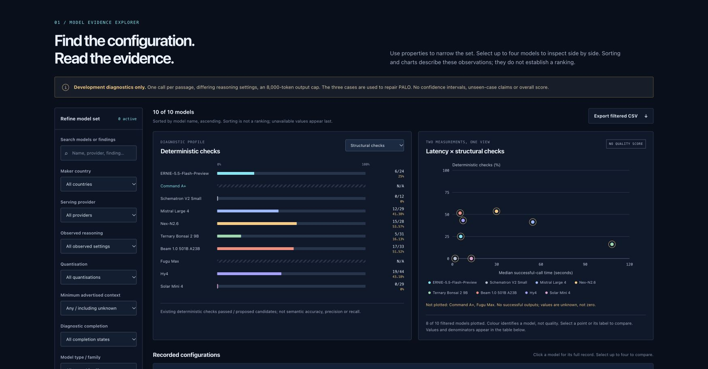

# Reading the evidence workspace

[Current 18-model catalogue and internal tests](https://paloframework.org/PALO_BlueprintBench_Leaderboard.html). The internal procurement view supports sorting, filters, source/output inspection and a request ledger. Counts use assigned tasks, missing values stay distinct from zero, and contested-label sensitivity remains separate from the primary analysis. No PBI is assigned.

## Historical adapter diagnostics

[Open the live explorer](https://paloframework.org/PALO_BlueprintBench.html#explorer).

Actual retained capture; current wording and configuration disclosures have since been updated. It illustrates development diagnostics, not a qualified leaderboard.

## Use the controls

Filter by model text, maker country, serving provider, observed reasoning, quantisation, advertised context, completion and family. Select up to four configurations for comparison. Export the filtered CSV to inspect the disclosed configuration fields and notes.

## Read each measurement with its boundary

- Structural checks count accepted candidates under the retained deterministic checker. They are not semantic precision or recall.
- Latency summarises successful calls; completed/attempted counts disclose the denominator. Failed calls are not assigned artificial zero latency.
- Unknown charge values are separate from unresolved reservations and reported charges. These are not invoice-reconciled enterprise totals.
- Advertised context is not used context. Maker country does not establish data residency.
- Settings differ across the ten historical configurations. Sorting is not a scientifically supported rank.

The published set contains 26 retained attempts and no qualified held-out result. The model-output archive is inspectable and its structural counts can be replayed offline. That replay does not rerun models or supply independent semantic gold.

[Diagnostic data](https://github.com/sev7enITA/PALO-BlueprintBench/blob/main/web/assets/blueprintbench/explorer-data.json) | [[Reproducing results|Reproducing-results]] | [[Metrics|Metrics]]

## Internal cross-model review

The [review panel](https://paloframework.org/PALO_BlueprintBench_Diagnostics.html#adversarial-review) exposes 96/108 assigned judgments from GLM, Gemini and local Qwen over 36 selected items. Three items have observed disagreements. Missing GLM responses, Qwen array projection, source references and raw responses are retained. This purposive internal test does not change the primary scores or establish independent validation. [Protocol and evidence](https://github.com/sev7enITA/PALO-BlueprintBench/tree/4494d6b/internal_tests/2026-11-11-adversarial).

## Revision 2026-11-11.3

Numerical quality, completion, cost and time ranks are suspended. The explorer retains descriptive sorting, configuration filters, charts, comparison and CSV/JSON exports. Agreement on classified responses, coverage and matches across all assigned opportunities are separate measures. The near-ceiling synthetic pilot cannot establish model superiority. Reviewer capture diagnostics are separate from model results.

[Next-cycle case coverage and label adjudication](https://github.com/sev7enITA/PALO-BlueprintBench/blob/main/docs/next-cycle-plan.md) describes draft development cases and human review gates. Coverage completeness is not statistical sufficiency.
