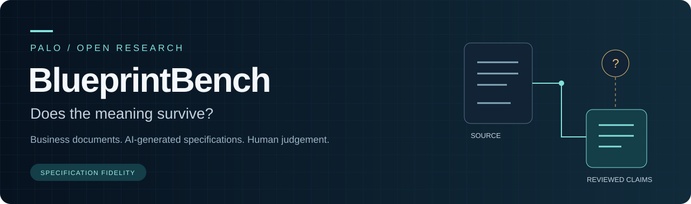

# PALO BlueprintBench handbook

**Specification fidelity: preserving business meaning when AI turns documents into development blueprints.**

This handbook explains the research question, the executable evaluator and how to participate. The project is a public research pilot. There are **zero qualified held-out results** and **no assigned PALO Blueprint Index score**.

## Choose your route

| I want to... | Start here |
|---|---|
| Understand the benchmark | [[Method and scope|Method-and-scope]] |
| Run the synthetic evaluator | [[Quick start|Quick-start]] |
| Interpret the charts | [[Explorer and results|Explorer-and-results]] |
| Inspect metrics and denominators | [[Metrics|Metrics]] |
| Audit the evidence contract | [[Evidence contract|Evidence-contract]] |
| Reproduce the archived checks | [[Reproducing results|Reproducing-results]] |
| Contribute expertise or cases | [[Contributing|Contributing]] |
| Understand qualification gates | [[Qualification and roadmap|Qualification-and-roadmap]] |
| Compare other benchmarks | [[Benchmark references|Benchmark-references]] |
| Find a short answer | [[FAQ|FAQ]] |

## Available now

The evaluator has an executable JSON Schema, raw-output binding, annotation-consistency checks and calculated task acceptance. The retained release verification reports 42 passing tests and 26 matching historical offline reproductions. These establish bounded software behaviour, not semantic validity or an independent ranking.

[Live explorer](https://paloframework.org/PALO_BlueprintBench.html) | [Research repository](https://github.com/sev7enITA/PALO-BlueprintBench) | [Release v0.3.0-pilot.1](https://github.com/sev7enITA/PALO-BlueprintBench/releases/tag/v0.3.0-pilot.1)

The wiki source is versioned in [`wiki/`](https://github.com/sev7enITA/PALO-BlueprintBench/blob/main/wiki). The repository's executable schema and versioned protocol remain the authoritative technical references. Wiki edits must be reconciled with that source before the next sync.
